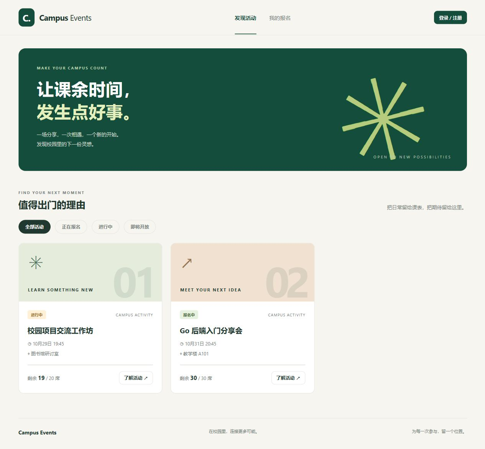
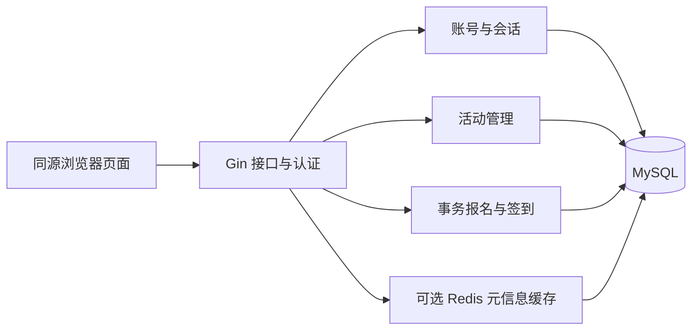

# Campus Events · 校园活动报名与签到系统

一个面向 Go 后端实习与应届求职的个人项目。组织者发布有限名额的校园活动，学生报名和取消，组织者在现场核验签到。

业务代码独立实现，使用 Go、Gin、GORM、MySQL，以及可选的 Redis 静态信息缓存。页面由 Go 服务直接提供，前端无需单独安装或构建。



## 功能

| 模块 | 已实现 |
| --- | --- |
| 账号 | 学生注册、bcrypt 密码哈希、JWT 登录、服务端会话校验、退出撤销当前会话、基础登录限流 |
| 活动 | 创建与编辑草稿、发布、公开列表和详情、活动状态计算、组织者权限隔离 |
| 报名 | 事务报名、防重复占名额、取消释放名额、取消后重新报名、本人报名记录 |
| 签到 | 组织者查看名单、活动时间内签到、重复签到返回原结果 |
| 缓存 | 可选 Redis 静态信息缓存，实时名额仍查 MySQL；Redis 故障回源 |
| 页面 | 活动发现、筛选、登录注册、我的报名、草稿编辑发布、名单和签到 |
| 工程 | 参数校验、请求日志与 request_id、健康与就绪检查、优雅退出、SQL 初始化、测试、Compose、GitHub Actions |

明确范围：这是完整的个人练习与作品展示版本，不包含支付、候补队列、邮件短信、二维码防伪、复杂审批和微服务。没有真实用户量或线上吞吐数据。

## Windows 本地完整运行

前提：安装了 Go 1.24+，以及 MySQL 的 mysqld、mysql、mysqladmin 可执行文件。本机的 Go 1.27.2 / MySQL 5.7.44 已实测；MySQL 8.4 已在 GitHub CI 中通过集成测试。

在项目根目录的 PowerShell 执行：

```powershell
.\scripts\start-local.ps1
```

脚本自动查找 `Program Files\MySQL\MySQL Server *\bin`，在项目 `.run/` 中建立独立数据库数据目录，使用 33088 端口，只监听本机；生成本地数据库密码和 JWT 密钥、初始化表与演示数据，然后启动服务。

它不安装软件，不启动或修改 Windows 中已有的 MySQL 服务，不修改 PATH 或执行策略。自定义路径或端口：

```powershell
.\scripts\start-local.ps1 -Port 8082 -MySQLBin 'C:\Program Files\MySQL\MySQL Server 5.7\bin'
```

看到 `server starting` 日志后打开 **http://127.0.0.1:8080/**，端口随 `-Port` 参数变化。初始化后有两个演示账号：

| 用户名 | 密码 | 作用 |
| --- | --- | --- |
| student_demo | CampusDemo123! | 报名、取消、查看本人记录 |
| organizer_demo | CampusDemo123! | 管理活动、查看名单、核验签到 |

这是本地脚本配置的演示密码，首次运行后写入被忽略的本地配置。正常注册的账号只会是学生，客户端不能选择组织者角色。

按 Ctrl+C 退出；脚本会关闭它本次启动的独立 MySQL 进程。再次启动复用本地数据与密钥。演示活动的时间以首次初始化为准，后续启动不篡改已存在活动的时间、密码或报名记录。

如果 PowerShell 策略阻止运行脚本，可使用下文直接 Go 启动方式；项目不要求更改系统执行策略。

## 不使用数据库的只读预览

```powershell
$env:APP_DATA_SOURCE = 'demo'
go run ./cmd/server
```

此模式只能查看内置活动，页面会显示预览说明。登录和写入接口返回 READ_ONLY_MODE；不要用它验证事务、持久化或数据库性能。真正完整体验使用上一节的脚本或 MySQL 模式。

## 已有 MySQL 的直接启动方式

使用数据库管理员先创建独立开发库和项目账号（替换示例密码）：

```sql
CREATE DATABASE campus_events_dev CHARACTER SET utf8mb4 COLLATE utf8mb4_unicode_ci;
CREATE USER 'campus'@'127.0.0.1' IDENTIFIED BY 'your-database-password';
GRANT SELECT,INSERT,UPDATE,DELETE,CREATE,INDEX,REFERENCES
ON campus_events_dev.* TO 'campus'@'127.0.0.1';
```

在 PowerShell 中：

```powershell
$env:APP_DATA_SOURCE = 'mysql'
$env:APP_ADDR = '127.0.0.1:8080'
$env:MYSQL_HOST = '127.0.0.1'
$env:MYSQL_PORT = '3306'
$env:MYSQL_USER = 'campus'
$env:MYSQL_PASSWORD = 'your-database-password'
$env:MYSQL_DATABASE = 'campus_events_dev'
$env:JWT_SECRET = [guid]::NewGuid().ToString('N') + [guid]::NewGuid().ToString('N')
$env:SEED_PASSWORD = 'choose-your-demo-password'
go run ./cmd/seed
go run ./cmd/server
```

seed 只接受 `campus_events_*` 专用数据库，创建表并补齐演示数据，不删除已有数据。已有演示账号不会重置密码；第一阶段禁用的账号会升级为可登录的演示账号。服务启动不自动建表，数据库不可用时不会静默回退为演示模式。

直接 Go 启动时不会自动读取 `.env`。需要 Redis 时在启动前设置 `REDIS_ADDR=127.0.0.1:6379` 与可选的 `REDIS_PASSWORD`；不配置即可正常完成全部业务。JWT_SECRET 至少 32 字节，重新生成会使旧令牌失效。

## Docker Compose

```powershell
Copy-Item .env.example .env
# 编辑 .env，替换数据库密码、JWT_SECRET 和 SEED_PASSWORD。
docker compose up --build -d
```

Compose 包含 MySQL 8.4、Redis、一次性 seed 和 Go 应用。依赖健康后初始化数据，再启动应用；应用绑定到本机 8080，数据库与 Redis 不暴露宿主端口。停止使用 `docker compose down`，保留数据卷。

当前电脑没有 Docker，完整 Compose 启动流程尚未实跑。GitHub CI 已实际启动 MySQL 8.4 容器，并通过集成测试、Linux race 检查与构建。[首次 CI 验证记录](https://github.com/Blessing-BOS/campus-events/actions/runs/40888836840)。

## 测试

```powershell
go test ./...
go vet ./...
go build ./cmd/server
node --check web/app.js
```

普通测试覆盖 HTTP 边界、参数校验、公开数据过滤、活动时间、错误结构和限流。没有数据库配置时，真实 MySQL 测试会明确跳过。

真实集成测试需先创建独立的 `campus_events_local_test` 库，并配置拥有该库建表和数据操作权限的 MySQL 账号：

```powershell
$env:MYSQL_DATABASE = 'campus_events_local_test'
$env:CAMPUS_TEST_MYSQL = '1'
go test -count=1 -v ./...
Remove-Item Env:CAMPUS_TEST_MYSQL
```

测试拒绝非 `campus_events_*_test` 库。实际测试过 20 人竞争 5 席、重复报名与取消、重新报名、事务回滚、权限隔离、签到、令牌撤销及缓存故障回源。Redis 场景使用 miniredis 的兼容协议测试实例，未实跑本机 Redis 服务。详见 [完整版本验收记录](docs/完整版验收.md)。

## 核心设计



同一活动的报名、取消与签到先锁定活动行，按一致顺序读取报名，再在同一事务内修改报名与计数；`(event_id,user_id)` 唯一约束防止同一个人产生多条报名。发布后的活动时间与名额锁定，减少状态转换范围。

JWT 只承载身份与会话 ID，服务端查询会话和用户真实角色；退出删除当前会话。访问令牌有效期两小时，前端只在 sessionStorage 保存令牌，不保存密码。

Redis 只缓存标题、地点、介绍和时间等公开元信息。缓存命中仍读取数据库的状态与当前名额；报名决策完全由 MySQL 负责。当前缓存减小详情读取的字段范围，不声称减少数据库请求次数或实现了性能提升。

当前单活动行锁会限制热点活动的并行度，基础限流也只在单进程生效。本项目没有凭空加入分布式锁或队列；后续优化应先测量再决定。公开部署需自行配置 HTTPS、账号与密钥管理。

## 目录与文档

```text
cmd/server/                 服务入口
cmd/seed/                   初始化与演示数据
internal/account/           账号、JWT 与会话
internal/event/             活动查询、草稿与发布
internal/registration/      报名、取消、签到与事务
internal/httpapi/           路由、权限、限流与集成测试
internal/platform/          配置、MySQL 与 Redis
migrations/                 建表 SQL
web/                        嵌入 Go 二进制的页面和静态资源
scripts/                    Windows 启动与 HTTP 检查
docs/                       接口、设计、验收与截图
```

- [完整接口说明](docs/API.md)
- [完整版本验收记录](docs/完整版验收.md)
- [设计方案及实现差异](docs/项目设计方案.md)
- [上传 GitHub 前的准备](docs/GitHub发布准备.md)
- [活动管理截图](docs/screenshots/manage.png) · [签到截图](docs/screenshots/check-in.png)

原第一阶段文档保留作开发历史，当前能力和启动步骤以本 README 为准。项目使用 AI 辅助实现；学习拆解将在完整版本之后进行。第三方依赖保留各自许可，本仓库的发布许可证待作者在公开前选择。
